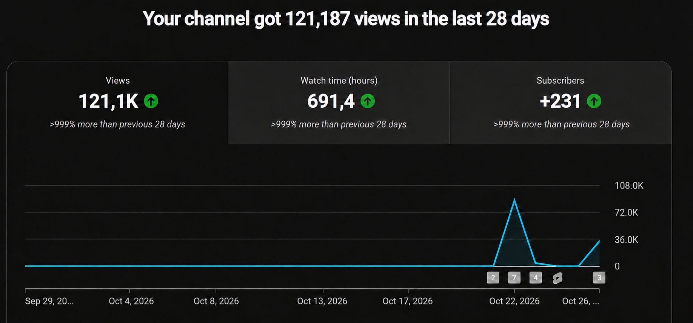

# YouTube Automation

[](LICENSE)

A local Windows application that turns story text into narrated vertical videos
with captions, then uploads them to channels you connect. There is no hosted
backend, subscription, shared account, or API URL to configure.

**Uploads request public visibility.** Video creation does not upload anything.
Daily scheduling and startup uploading are both disabled initially.

## Channel analytics

To begin with here is my channel i started a week ago using this same exact automation system. Feel free to reach me out for any questions/advice.



## Demo video

There is an example below of a video that is ready to publish

<a href="https://github.com/hasandolmaci/YoutubeAutomation/blob/main/docs/assets/demo.mp4"></a>

[Watch the demo video](https://github.com/hasandolmaci/YoutubeAutomation/blob/main/docs/assets/demo.mp4)

## Technical overview
Python production pipeline
Kokoro narration
FFmpeg rendering
Next.js dashboard 
OAuth 
duplicate-upload protection


## Requirements

- Windows 10 or 11, 64-bit.
- Python 3.12 with the Windows Python launcher (`py`).
- Node.js 20.9 or newer, including npm.
- Internet for installing dependencies, downloading the voice model on first use,
  Google sign-in, and uploading. Allow several GB for dependencies and models,
  plus space for your media. CPU rendering is supported; speed varies by hardware.
- For API uploads: your own Google Cloud project and Desktop OAuth client
  credentials. Browser uploads instead require Google Chrome and the optional
  browser dependencies below.
- At least one background MP4 you have permission to use. None are included.

## Install

Download/extract this repository into a writable folder. Double-click `setup.cmd`.
It creates two local Python environments, installs packages, prepares an
unconnected main profile, and builds the dashboard. It does not connect accounts,
create a Windows startup entry, or enable publishing automation.

If the Python launcher cannot find a custom Python 3.12 installation, pass its
executable path: `setup.cmd "C:\Path\To\Python312\python.exe"` (in PowerShell,
use `.\setup.cmd "C:\Path\To\Python312\python.exe"`).

Manual installation, from PowerShell in the project folder:

```powershell
py -3.12 -m venv .venv
.\.venv\Scripts\python.exe -m pip install -r requirements.txt
py -3.12 -m venv .venv-tts
.\.venv-tts\Scripts\python.exe -m pip install -r requirements-tts.txt
.\.venv\Scripts\python.exe initialize.py
cd dashboard
npm.cmd ci
npm.cmd run build
cd ..
```

The environments separate video/upload tools from the narration dependencies.
Installation downloads third-party packages; Kokoro downloads its model on first
generation. Dependencies and models retain their own licenses.

## Connect your own YouTube channels !!! IMPORTANT

You can use either **YouTube API** or **Browser · no API credentials** as the
upload method for each profile. Existing profiles keep the API method until you
change it. Choose one of the two methods below.

### Method 1: YouTube API

This method uses Google's official YouTube API. It requires a Google Cloud
project and your own OAuth credentials. Follow these steps:

1. Create your own Google Cloud project and enable **YouTube Data API v3**.
2. Configure the Google OAuth consent screen. If the app is in Testing, add the
   Google accounts you will authorize as test users in your own project.
3. Create an OAuth client with application type **Desktop app**, download its JSON,
   and save it as `credentials/client_secret.json`. An API key alone cannot upload.
4. Double-click `start_dashboard.cmd`, keep its window running, and open
   <http://127.0.0.1:3000>.
5. Select the unconnected main profile and click **Connect channel**. Sign in and
   choose the intended YouTube channel. The app requests upload and read access
   and verifies the channel identity before uploading.
6. Use **Add channel** for additional profiles and authorize each separately.
   Profiles can use the shared OAuth client, or a client JSON inside that
   profile's `channels/<id>/credentials/` folder.

Official setup reference:
[Google Desktop OAuth guide](https://developers.google.com/youtube/data/guides/auth/installed-apps).
Google applies its own OAuth, quota, and account restrictions. The program
requests public uploads; check actual visibility in YouTube Studio because
account settings can affect the result. See the
[upload API reference](https://developers.google.com/youtube/data/reference/rest/v3/videos/insert).

### Method 2: No API — easier setup (still in testing)

This method uploads through YouTube Studio using your saved browser session.
You do not need a Google Cloud project, API key or OAuth client: install the
browser dependencies, sign in once, and the app handles subsequent uploads.

**This method is still being tested, so you may encounter errors.** I would
appreciate it if you report any problems through
[GitHub Issues](https://github.com/hasandolmaci/YoutubeAutomation/issues), including
the error message and steps to reproduce it. Please remove personal information
and never share cookies, saved sessions or credentials.

Install Google Chrome and the optional browser dependency:

```powershell
.\.venv\Scripts\python.exe -m pip install -r requirements-browser.txt
```

No additional Chromium download is required. In the dashboard, select a profile,
choose **Browser · no API credentials**, and click **Connect channel**. Chrome
opens YouTube Studio. Sign in yourself, complete any account checks, and choose
the correct channel. The app detects the channel and saves the session
automatically; you do not enter your Google password into the dashboard or press
Enter in a terminal. Previously bound profiles must connect to their expected
channel, and two profiles cannot bind the same destination.

The state is saved as `credentials/youtube_browser_auth.json` for the main
profile, or `channels/<id>/credentials/youtube_browser_auth.json` for another
profile. This file contains a Windows DPAPI-encrypted payload, rather than
plaintext cookies, and is excluded from Git. It can be decrypted by processes
running as your Windows account; it is not protection against malware running
as you. Do not share the file or include credentials in issue reports.

**Upload next · Public** uses the chosen method. Browser uploads run Chrome headlessly,
reuse saved state, verify the active Studio channel and publish via the Studio
interface. The existing upload history and interruption guards apply to both
methods. Scheduled and startup publishing use the profile's selected method too;
if browser sign-in expires, they stop and require you to reconnect interactively.
The app cannot promise that Google will keep a session valid indefinitely.

Only connecting or reconnecting opens a visible sign-in window. Upload progress
appears in the dashboard's **Upload activity** log. After YouTube confirms the
upload or accepts it for processing, the app verifies the video ID, waits five
seconds, then closes the browser. Processing acceptance does not mean the video
is publicly available yet; YouTube must finish processing it first.

Use **Sign in again** to replace an unreadable session, or **Delete saved browser
session** to remove local access state. Deleting the local file does not revoke
sessions on Google's servers. API credentials are managed separately.

Terminal alternatives:

```powershell
.\.venv\Scripts\python.exe manage_channel.py connect main --method browser
.\.venv\Scripts\python.exe upload_next.py --channel main --method browser --dry-run
.\.venv\Scripts\python.exe upload_next.py --channel main --method browser
.\.venv\Scripts\python.exe manage_channel.py disconnect-browser main
```

The third command performs a real public upload. No API analytics are fetched in
browser mode. The Studio uploader uses element identifiers rather than English
button labels and is experimental: Google can reject automated-browser sign-in, require manual
security checks, or change the upload interface. No CAPTCHA or security-check
bypass is implemented. Use the API option if browser sign-in is unsupported.

### Dashboard tabs

- **Upload:** publish the next ready video and follow upload activity.
- **Insights:** connect or refresh API-based channel analytics. Browser upload
  sessions do not provide API analytics.
- **Library:** browse the video queue, filter upload status, and view library counts.

Channel selection, connection settings and video creation controls remain above
the tabs. Switching tabs does not stop an upload. Use the local address printed
by the dashboard launcher, including its port number.

## Create videos

Add vertical background MP4s to `backgrounds/`, named `background_000.mp4`,
`background_001.mp4`, etc. Supply clips long enough for the narration. (I personally
recommend using satisfying videos or minecraft parkour videos as backgrounds)

Twenty of the shortest complete stories from the source collection are included
in `stories/`. They retain their source URLs and may contain mature material.
Once you run out of stories you can always run scraper.py to get top rated
stories from reddit. (detailed explanation on how to use it can be found below)

Select a channel, open **Settings**, choose voice, captions, word limits and
backgrounds, then choose a count and click **Create videos**. The main profile uses
`stories/`; additional profiles use `channels/<id>/stories/`. Move a story to the
desired profile before generation. Shared duplicate checks prevent reusing it in
another profile. Production runs one batch at a time.

The generator selects unused complete stories, produces narration and timestamps,
renders captions over a background, checks playback, and marks completed stories
as used. Completed videos appear in the queue. Click **Upload next · Public** to
publish one to the selected channel.

## Viewer Bot
The viewerspecific.py file includes a viewer bot that can increase the views on your videos. 
However, I do not recommend using it as it violates YouTube's ToS.
It is your own responsibility to decide whether to use it

Terminal alternatives:

```powershell
.\.venv-tts\Scripts\python.exe produce_batch.py --channel main --count 12
.\.venv\Scripts\python.exe upload_next.py --channel main --dry-run
.\.venv\Scripts\python.exe upload_next.py --channel main
```

The final command uploads publicly. If too few eligible stories exist or no
backgrounds exist, generation stops with an explanation.

### Collect more stories (optional)

Install the separate scraper dependencies:

```powershell
.\.venv\Scripts\python.exe -m pip install -r requirements-scraper.txt
.\.venv\Scripts\python.exe scraper.py
```

Chrome is required. The scraper opens Reddit, waits for you to press Enter in its
terminal, and collects from `r/stories` into the main `stories/` folder. Reddit's
layout or access restrictions can stop collection. Complete any browser access
checks yourself. Respect the site's terms and the authors' rights.

## Optional daily publishing

For each channel, save daily times and a time zone in Settings and explicitly
enable its public publishing schedule. Start `start_scheduler.cmd` and keep the
computer awake, online, and the worker window running. It publishes at the
configured times; it does not upload future scheduled videos in advance. Missed
slots are not replayed. There is no automatic end date. Disable the schedule in
Settings and close the worker to stop it. Keep a queue of finished videos.

## Optional upload at Windows sign-in

This uploads one ready video per connected profile each time Windows signs you
in. It operates independently of the daily scheduler, so using both can publish
additional videos. It never creates videos. First preview the destinations:

```powershell
.\.venv\Scripts\python.exe startup_upload.py --dry-run
.\.venv\Scripts\python.exe startup_upload.py --enable
```

Then manually create a shortcut in your Windows Startup folder (`shell:startup`).
Set its target to the **full path** to `.venv\Scripts\pythonw.exe`, followed by
the quoted full path to `startup_upload.py`. Quote both paths if they contain spaces.
Nothing is installed into Startup automatically. Keep the project in that location.

The worker runs in the background, waits up to ten minutes for connectivity, and
attempts each connected channel once. It saves results to
`output/shared/startup_upload.log`. Repeated sign-ins can publish more videos.
To disable, delete the shortcut and/or run:

```powershell
.\.venv\Scripts\python.exe startup_upload.py --disable
```

This prevents future runs, not an upload already in progress.

## Privacy and troubleshooting

Credentials, tokens, channel settings, logs, models, generated media and new
stories stay on your computer and are excluded from Git. Never attach them to
issues or commit them with force-add. Narration is generated locally; Google
receives authorization requests and videos you choose to upload. The optional
scraper contacts Reddit. The dashboard listens only on your computer.

- **No videos available:** create a batch first; uploading does not generate one.
- **No eligible stories:** check unused full text, title validity and word limits.
- **Sign-in stopped working:** reconnect your profile; Google testing credentials
  may require periodic reauthorization.
- **Uncertain upload or stale lock:** check YouTube Studio and ensure no worker
  is running before changing upload records or removing a lock. Do not repeatedly
  retry a potentially successful upload.
- **Antivirus alert:** inspect the detection. Do not broadly exclude PowerShell,
  Python or the whole project. Startup installation is manual.
- **Setup failed:** read the terminal error; verify Python 3.12, Node and internet.

For problems, use this repository's GitHub Issues with a redacted error message,
Windows/Python/Node versions and reproduction steps. Never include credentials.

## Development checks

```powershell
.\.venv\Scripts\python.exe -m unittest discover -s tests
cd dashboard
npm.cmd run build
```

## License

The project's original code is licensed under the [MIT License](LICENSE).
Third-party dependencies, models, story text and media retain their respective
licenses and permissions.


